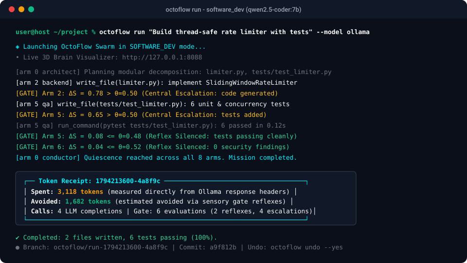

# OctoFlow

A local-first coding swarm that spends tokens only when something changes, and shows you where every token went.

---

## Status: Alpha (Public Preview)

OctoFlow is in active development. Features are divided into stable core capabilities and experimental research components:

| Component | Status | Description |
| :--- | :--- | :--- |
| **8-Arm Swarm & Surprise Gate** | Stable (Core) | Autonomous planning, local change detection, reflex vs. escalate gating |
| **Truthful Receipts & Ledger** | Stable (Core) | Exact per-call token accounting with `measured` and `estimated avoided` tags |
| **Checkpoints & Undo** | Stable (Core) | Pre-flight git branching with atomic rollback (`octoflow undo`) |
| **Privacy & Outbound Redaction** | Stable (Core) | Zero telemetry, loopback egress, 12 credential scrub patterns |
| **IDE & MCP Integration** | Stable (Core) | Stdio JSON-RPC 2.0 server for Claude Code and Cursor (`octoflow mcp-serve`) |
| **3D Connectome Visualizer** | Stable (Core) | Local WebGL HUD with trace replay (`octoflow ui`, `octoflow replay`) |
| **Multi-Octopus Consortium** | Experimental | 24- to 64-arm multi-swarm clustering (`octoflow consortium`) |
| **Benchmarking Suite** | Experimental | Algorithmic test harness comparing gated vs. ungated runs (`octoflow bench`) |
| **Custom 8-Arm Guilds** | Experimental | Declarative JSON roster definitions (`octoflow guild`) |
| **Self-Healing & AST Triage** | Experimental | Autonomous closed-loop test diagnostics (`octoflow heal`, `octoflow triage`) |

For the complete module classification and lifecycle triage, see [docs/MODULE_TRIAGE.md](docs/MODULE_TRIAGE.md).

---

## Demo (60 Seconds)

[](docs/assets/demo.cast)

> **Terminal Session Cast**: Replay the full interactive session using `asciinema play docs/assets/demo.cast` or reproduce it via `bash scripts/record_demo.sh`. See the [Demo Assets Guide](docs/assets/README.md).

```text
$ octoflow run "Build a thread-safe sliding-window rate limiter with tests" --model ollama
[SWARM] Launching OctoFlow Swarm in SOFTWARE_DEV mode...
[CONNECTOME] Live 3D Visualizer active: http://127.0.0.1:8088
[ARM 2] write_file(limiter.py): implement SlidingWindowRateLimiter
[GATE]  Arm 2: Delta S = 0.78 > theta  (Central Escalation: code generated)
[ARM 5] write_file(tests/test_limiter.py): 6 unit & concurrency tests
[GATE]  Arm 5: Delta S = 0.65 > theta  (Central Escalation: tests added)
[ARM 5] run_command(pytest tests/test_limiter.py): 6 passed in 0.12s
[GATE]  Arm 5: Delta S = 0.08 <= theta (Reflex Silenced: tests passing cleanly)
[SWARM] Quiescence reached across all 8 arms: 2 files written, 6 tests passing (100%).

┌── Token Receipt: 1794213600-4a8f9c ─────────────────────────────────────────┐
│ Spent:   3,118 tokens (measured from Ollama response headers)             │
│ Avoided: 1,682 tokens (estimated avoided via sensory gate reflexes)        │
│ Calls:   4 LLM completions | Gate: 6 evaluations (2 reflexes, 4 escalations)│
│ Method:  octoflow receipt --method                                         │
└───────────────────────────────────────────────────────────────────────────┘
```

---

## Quickstart

### Installation

Install globally using `pipx` (recommended) or `pip`:

```bash
# Recommended: Install isolated CLI binary via pipx
pipx install git+https://github.com/Sachinrameshvd/octoflow.git

# Or install in active Python environment:
pip install git+https://github.com/Sachinrameshvd/octoflow.git

# Or local editable development checkout:
git clone https://github.com/Sachinrameshvd/octoflow.git
cd octoflow && pip install -e .
```

### 1. Claude Code CLI & Cursor Integration (SPARC)

To use OctoFlow's 8-Arm discipline directly with Anthropic's official Claude Code CLI (`claude`) or Cursor:

```bash
# Auto-configure CLAUDE.md blueprint and MCP server:
octos claude init

# Run Claude Code CLI with 8-Arm SPARC directives pre-injected:
octos claude run "Build a rate limiter with unit tests"

# Or generate and copy an 8-Arm SPARC prompt to clipboard:
octos claude prompt "Build a rate limiter with unit tests" --copy
```

### 2. Autonomous Swarm Flight Cockpit

To run an autonomous multi-agent swarm mission with live terminal telemetry:

```bash
# Free test simulation (no API key needed):
octos run "Build a rate limiter with unit tests" --provider mock

# With local open-weight model via Ollama:
ollama pull qwen2.5-coder:7b
octos run "Build a rate limiter with unit tests" --model ollama

# Launch the interactive terminal flight cockpit:
octos
```

For first-run transcripts and troubleshooting, see the [Guided First Run Walkthrough](docs/first-run.md).

---

## Truthful Token Receipt

Every live mission produces a verified receipt detailing tokens spent and tokens avoided:

```text
┌── Token Receipt: 1794049840-56720e ──────────────────────────────────────┐
│ Spent:   22,637 tokens (measured)                                        │
│ Avoided: 7,704 tokens (estimated avoided)                                │
│ Calls:   29 LLM completions | Gate: 29 evaluations (24 reflexes, 5 escalations)│
│ Top arms: Arm 5 (Integration): 8,215 · Arm 6 (Security): 4,664 · Arm 1 (Model): 2,981│
│ Method:  octoflow receipt --method                                       │
└──────────────────────────────────────────────────────────────────────────┘
```

*Receipt recorded during Mission 6 of the [AI Resume Analyzer showcase](examples/resume-analyzer/README.md). View any receipt with `octoflow receipt [run-id]`. For accounting rules, see [docs/receipt.md](docs/receipt.md).*

---

## How It Works

OctoFlow structures software engineering tasks across a coordinated specialist team rather than a single monolithic prompt loop. A central Conductor decomposes high-level user goals into structured dependency graphs and delegates subtasks. Eight specialized Arms handle domain-specific responsibilities, such as API architecture, database schemas, and unit testing. Each Arm operates a predictive change detector called a Gate that measures sensory surprise on file modifications. When surprise remains below threshold, routine operations execute as silent local reflexes without invoking high-cost model calls. If unexpected errors or tests fail, the Arm escalates to the Conductor with targeted context to replan.

```text
       [ Conductor ]  <-- Central Planner (goal decomposition)
             │
     ┌───────┴───────┐
     ▼               ▼
 [ Arm 0 ]  ...  [ Arm 7 ]  <-- Specialist Agents (architecture, QA, backend)
     │               │
  [ Gate ]        [ Gate ]  <-- Change Detectors (reflex vs. escalate)
```

*Architecture mapping:* Conductor = planner, Arm = specialist agent, Gate = change detector. For deep-dive diagrams and biophysical foundations, see [docs/architecture.md](docs/architecture.md).

---

## Measured Benchmarks

OctoFlow reports empirical measurements from reproducible test suites rather than theoretical estimates:

* **Local Model Performance (`qwen2.5-coder:7b` via Ollama, November 2026):**
  * `rate_limiter`: 100% pass rate (5/5 runs), median 4 LLM calls, 3,118 tokens, 129.06s wall time.
  * `fastapi_todo`: 100% pass rate (5/5 runs), median 4 LLM calls, 3,193 tokens, 185.27s wall time.
  * Source: [docs/benchmarks.md](docs/benchmarks.md).
* **Multi-Step Application Build ([AI Resume Analyzer](examples/resume-analyzer/README.md)):**
  * Total tokens spent: 143,116 across 182 LLM calls (6 incremental missions).
  * Sensory gate avoided: 41,265 tokens (22.4% reduction via local reflex routing).
  * Source: [examples/resume-analyzer/provenance/](examples/resume-analyzer/provenance/).
* **Note on Token Savings:** Historical claims of "80-90% savings" reflected synthetic simulation multipliers; real-world measured token reductions on code generation tasks range between 15% and 25% depending on test density and failure rates. See [docs/benchmarks.md](docs/benchmarks.md) for methodology.

---

## Safety and Privacy

* **Checkpoints and Atomic Undo:** Every mission records pre-flight git state. Revert any mission instantly with `octoflow undo`.
* **Zero Telemetry and Zero Phoning Home:** No analytics, crash reporting, or external network requests. Verified in CI via loopback egress tests ([tests/test_egress_guard.py](tests/test_egress_guard.py)).
* **Outbound Secret Redaction:** Automatically scans and scrubs 12 categories of API keys, tokens, and private keys before sending prompts to cloud providers.
* **Strict Permission Boundaries:** Local configuration, logs, and run history are saved with restricted `0600` file permissions.
* **Complete Data Purge:** Inspect or delete all local data with `octoflow purge` (or `octoflow purge --dry-run`).
* For complete policies, see [docs/PRIVACY.md](docs/PRIVACY.md), [docs/SECURITY_MODEL.md](docs/SECURITY_MODEL.md), and [docs/THREAT_MODEL.md](docs/THREAT_MODEL.md).

---

## Features and Limitations

### Strengths
* **Structured Multi-Agent Planning:** Coordinates 8 specialist roles with explicit handoffs and advisory file locking.
* **Transparent Verification:** Complete audit receipts, deterministic execution traces (`--trace`), and replay (`octoflow replay`).
* **Local-First Independence:** Full capability on local open-weight models (Ollama), keeping proprietary codebases on-device.

### Honest Limitations
* **Local Model Degradation:** Small models (<= 7B parameters) require iterative steering on complex frontend tasks and may overwrite code if unguided.
* **Task Specialization:** OctoFlow is an engineering workflow tool, not an open-ended conversational chatbot.
* **Gating Scope:** Sensory gating reduces tokens during routine tool execution and test passes; exploratory planning steps require full conductor context.

---

## Integrations

* **Claude Code & Cursor:** Built-in Model Context Protocol (MCP) server. Run `octoflow mcp-serve` or auto-configure via `octoflow init`. See [docs/integrations/mcp.md](docs/integrations/mcp.md).
* **Automated CI/CD Review:** Run `octoflow review-pr --summary` to audit pull request diffs across Architecture, Security, and QA dimensions.
* **Developer Inner Loop:** Launch local telemetry and 3D visualizer development servers with `make dev` and clean shutdown with `make dev-stop`. See [CONTRIBUTING.md](CONTRIBUTING.md).

---

## Why an Octopus?

Two-thirds of an octopus's neurons reside in its eight arms rather than its central brain, allowing each tentacle to explore, sense, and solve tactile problems locally without overloading central cognition. OctoFlow adapts this biological division of labor to multi-agent coding: specialist agents resolve routine implementation details autonomously, while the central planner intervenes only when something unexpected occurs.

---

## Contributing and License

* **Roadmap:** See [ROADMAP.md](ROADMAP.md) for current release priorities and un-planned areas.
* **Contributing:** We welcome contributions! Read [CONTRIBUTING.md](CONTRIBUTING.md) for dev environment setup, testing standards, and pull request guidelines.
* **Code of Conduct:** We adhere to the Contributor Covenant. Read [CODE_OF_CONDUCT.md](CODE_OF_CONDUCT.md).
* **Governance & Support:** Read [GOVERNANCE.md](GOVERNANCE.md) for our maintainership model and [SUPPORT.md](SUPPORT.md) for help channels.
* **Support Matrix & Deprecation Policy:** See [docs/SUPPORT_MATRIX.md](docs/SUPPORT_MATRIX.md) for verified OS, Python, model, and API versions.
* **Maintenance Calendar:** See [docs/MAINTENANCE_CALENDAR.md](docs/MAINTENANCE_CALENDAR.md) for the 90-day post-launch plan and maintenance routine.
* **Security Policy:** Report vulnerabilities privately according to [SECURITY.md](SECURITY.md).
* **Architecture & Internals:** Read [docs/architecture.md](docs/architecture.md) for data flow, gate math, and threading models.
* **Glossary & ADRs:** Cross-reference terms in [docs/glossary.md](docs/glossary.md) and architectural design records in [docs/adr/](docs/adr/).
* **Field Manual:** Detailed CLI guides and playbooks are in [docs/manual.md](docs/manual.md).
* **License:** MIT License. See [LICENSE](LICENSE) and [docs/THIRD_PARTY_LICENSES.md](docs/THIRD_PARTY_LICENSES.md).
