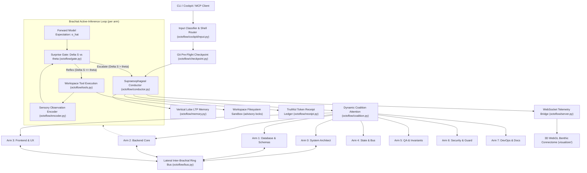
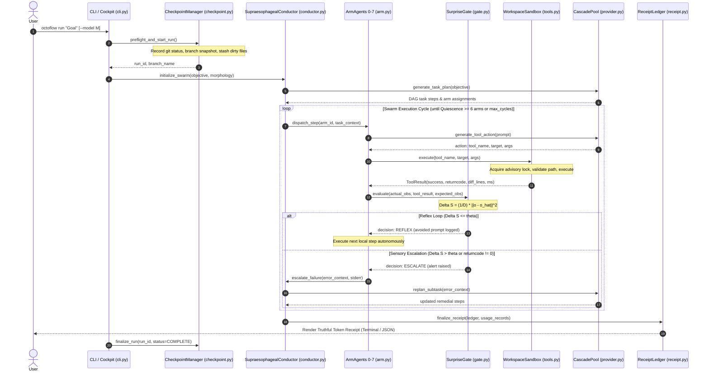

# OctoFlow: System Architecture, Data Flow & Developer Field Guide

This document is the definitive technical architecture guide for OctoFlow (OctopusBrain). It details the system's design patterns, module boundaries, data and control flow, concurrency model, gate mathematics, and extension interfaces.

---

## Table of Contents

1. [High-Level Architecture Overview](#1-high-level-architecture-overview)
2. [Module Map & Responsibility Matrix](#2-module-map-responsibility-matrix)
3. [The Run Lifecycle: End-to-End Sequence Diagram](#3-the-run-lifecycle-end-to-end-sequence-diagram)
4. [Data & Control Flow](#4-data-control-flow)
5. [Storage Layout & State on Disk](#5-storage-layout-state-on-disk)
6. [Concurrency, Threading & Async Model](#6-concurrency-threading-async-model)
7. [Cockpit Input Model & Non-Blocking Loop](#7-cockpit-input-model-non-blocking-loop)
8. [Extension Points & Plugin Contracts](#8-extension-points-plugin-contracts)
9. [Event-Triggered Sensory Gate Math & Worked Example](#9-event-triggered-sensory-gate-math-worked-example)
10. [System Design Constraints](#10-system-design-constraints)
11. [Biophysical & Neural Simulation Foundations](#11-biophysical-neural-simulation-foundations)

---

## 1. High-Level Architecture Overview

OctoFlow structures software engineering workflows across a decentralized-centralized cephalopod coordination model. Rather than funneling all reasoning through a single monolithic prompt context, tasks are decomposed across 8 specialized brachial arms that execute in parallel silence, reporting upward only when sensory change exceeds an adaptive threshold.



---

## 2. Module Map & Responsibility Matrix

The following table maps every major cephalopod metaphor to its conventional software engineering term, exact source file, primary responsibility, and stability classification per [`docs/MODULE_TRIAGE.md`](MODULE_TRIAGE.md):

| Metaphor Name | Plain Software Term | Source File | One-Line Responsibility | Stability |
| :--- | :--- | :--- | :--- | :--- |
| **Supraesophageal Ganglion** | Central Swarm Conductor | `octoflow/conductor.py` | Decomposes goals into DAG task steps, assigns coalitions, and arbitrates escalations. | **Core** |
| **Brachial Axial Nerve Cord** | Autonomous Specialist Agent | `octoflow/arm.py` | Executes active-inference tool cycles, manages local context, and handles reflexes. | **Core** |
| **Sensory Surprise Gate** | Event-Triggered Change Detector | `octoflow/gate.py` | Computes prediction error ($\Delta S$) against adaptive threshold ($\theta$) to suppress redundant LLM calls. | **Core** |
| **Decision Ledger** | Token Avoidance Ledger | `octoflow/gate.py` | Thread-safe recorder logging gate evaluations, reflex decisions, and estimated avoided tokens. | **Core** |
| **Sensory Receptive Field** | Observation Feature Encoder | `octoflow/encoder.py` | Transforms exit codes, stderr, diff size, latency, and error keywords into 16D vectors. | **Core** |
| **Inter-Brachial Ring Bus** | Lateral Event Bus | `octoflow/bus.py` | Ring-topology lateral message bus enabling direct neighbor-to-neighbor communication. | **Core** |
| **Vertical Lobe (VL)** | Associative Heuristic Cache | `octoflow/memory.py` | Persists long-term Hebbian synaptic weights and AST patterns across missions. | **Core** |
| **Coalition Binding** | Dynamic Task Force Matrix | `octoflow/coalition.py` | Extracts temporary collaborative arm groupings from cross-attention correlation matrices. | **Core** |
| **Subesophageal Motor Center** | Tool Execution Layer | `octoflow/tools.py` | Executes file I/O and CLI commands with advisory locks and path traversal protection. | **Core** |
| **Cascade Pool Provider** | Resilient LLM Router | `octoflow/provider.py` | Manages prioritized pools of local and cloud models with automatic fallback and usage accounting. | **Core** |
| **Pre-Flight Checkpoint** | Git State Snapshot & Undo | `octoflow/checkpoint.py` | Captures dirty working-tree snapshots and branches before execution, enabling instant rollbacks. | **Core** |
| **Truthful Token Receipt** | Honest Cost Ledger | `octoflow/receipt.py` | Renders terminal, JSON, and HTML audit receipts distinguishing measured from estimated tokens. | **Core** |
| **Benthic Connectome Server** | Local Telemetry Bridge | `octoflow/server.py` | Serves loopback WebSocket bridge (`127.0.0.1:8088`) streaming telemetry events to 3D visualizer. | **Core** |
| **Execution Trace Recorder** | Deterministic Replay Engine | `octoflow/trace.py` | Logs structured events to `trace.jsonl` (0600) and powers chronological terminal/3D replay. | **Core** |
| **Terminal Cockpit TUI** | Non-Blocking Terminal HUD | `octoflow/cockpit/app.py` | Renders the 20 FPS live status HUD, animated runner, and safe shell router. | **Core** |
| **Cockpit Shell Router** | Command Classifier & Guard | `octoflow/cockpit/input.py` | Parses user input into goals, shell commands, or slash directives with confirmation prompts. | **Core** |
| **Model Context Protocol** | Stdio Tool Server | `octoflow/mcp.py` | Exposes 8 conformant JSON-RPC 2.0 tools for native integration with Claude Code and Cursor. | **Core** |
| **Multi-Octopus Consortium** | Multi-Swarm Scaling | `octoflow/consortium.py` | Scales execution across Triad (24 arms) and Octopolis (64 arms) for monorepos and full-stack apps. | **Experimental** |
| **Algorithmic Benchmarking** | Reproducible Eval Harness | `octoflow/bench.py` | Standardized challenge suite comparing gated vs. ungated runs across algorithmic challenges. | **Experimental** |
| **Custom 8-Arm Guilds** | Declarative Roster Schema | `octoflow/commands/guild.py` | Validates and loads community 8-arm specialist roster definitions from JSON files. | **Experimental** |
| **Automated Self-Healing** | Closed-Loop Test Repair | `octoflow/healing.py` | Coordinates Arm 5 (QA) and Arm 2 (Backend) to diagnose failures and apply AST patches. | **Experimental** |
| **Diff Triage & AST Review** | Interactive Patch Review | `octoflow/triage.py` | Interactive file-by-file AST syntax validator and diff triage tool. | **Experimental** |
| **Zero-Trust Federation Guard** | Credential & PII Redactor | `octoflow/federation.py` | 14-rule regex redactor protecting outbound prompts, logs, and telemetry against secret leaks. | **Core (Redactor)** |

---

## 3. The Run Lifecycle: End-to-End Sequence Diagram

The following sequence diagram traces the complete lifecycle of an `octoflow run` mission from user input to final quiescence and receipt delivery:



---

## 4. Data & Control Flow

### Input Ingestion & Routing
1. **User Request Ingestion:** User commands enter via the CLI entrypoint (`octoflow.cli:app`), the interactive Cockpit (`octoflow.cockpit:run_cockpit`), or the MCP server (`octoflow.mcp`).
2. **Classification:** Inputs pass through `octoflow.cockpit.input.classify_input()`, resolving deterministically into a `SWARM_GOAL`, `SHELL_SIMPLE`, `SHELL_EXPLICIT`, `SLASH_COMMAND`, or `EMPTY`.
3. **Morphology Resolution:** If multi-octopus consortium execution is triggered, `octoflow.consortium.detect_morphology_from_objective()` selects the optimal morphology (`SOFTWARE_DEV`, `FULLSTACK_AI`, or `AIML_RESEARCH`) based on domain keywords and system RAM bounds.

### Active-Inference Execution Pipeline
1. **Goal Decomposition:** The central conductor prompts the primary reasoning provider to decompose the mission into an execution plan with discrete arm assignments.
2. **Predictive Coding Cycle:**
   - The arm prepares an action and projects an expected outcome vector $\hat{o}_t \in \mathbb{R}^{16}$.
   - The tool executes in the workspace via `WorkspaceSandbox`.
   - `CodeSensoryEncoder` encodes actual results into $o_t \in \mathbb{R}^{16}$.
   - `SurpriseGate.evaluate()` computes sensory surprise $\Delta S_i = \min(1.0, 4 \times \frac{1}{D}\|o_t - \hat{o}_t\|^2)$.
3. **Reflex vs. Escalation Arbitration:**
   - **Reflex ($\Delta S_i \le \theta$):** The arm proceeds silently. Avoided prompt tokens are recorded in `DecisionLedger`. Threshold $\theta$ decays toward baseline.
   - **Escalation ($\Delta S_i > \theta$):** Unexpected tool failure or non-zero return code forces escalation. The arm requests central conductor attention with targeted error telemetry. Threshold $\theta$ elevates slightly to prevent panic loops.
4. **Quiescence:** When an arm fulfills all assigned objectives without further escalations, it marks `is_quiescent = True`. Once $\ge 6$ arms reach quiescence, the swarm enters completion phase.

---

## 5. Storage Layout & State on Disk

All local configuration, run history, and telemetry artifacts follow strict access controls:

| Path | Mode | Retention / Lifecycle | Purpose & Data Content |
| :--- | :---: | :--- | :--- |
| `~/.octoflow/config.json` | `0600` | Persistent | Global settings: default provider, models, scale, themes, OS keyring fallback keys. |
| `~/.octoflow/logs/octoflow.log` | `0600` | Rotating (1 MB x 3) | Diagnostic log files; all credentials and secrets scrubbed via `RedactionFilter`. |
| `~/.octoflow/runs/<run_id>/meta.json` | `0600` | Persistent | High-level goal, branch tracking, files modified, token counts, timestamps. |
| `~/.octoflow/runs/<run_id>/trace.jsonl` | `0600` | Persistent (with `--trace`) | Structured execution events (gate evaluations, tool calls, provider metadata). Omit prompts by default. |
| `~/.octoflow/memory/` | `0600` | Persistent | Hebbian synaptic weights, associative AST heuristics, and frequency counts. |
| `~/.octoflow/guilds/*.json` | `0600` | Persistent | User-defined declarative 8-arm specialist roster definitions. |
| `<workspace>/.octoflow/` | `0700` | Ephemeral / Purgeable | Workspace local cache, advisory lock files (`.lock`), and session history. |
| `<workspace>/.octoflow-mission/` | `0700` | Managed per-mission | Git checkpoint branch metadata and dirty-tree stash commits for atomic rollbacks (`octoflow undo`). |
| `<workspace>/octoflow-audit-*.html` | Standard | User export | Self-contained HTML audit reports generated upon explicit user request (`octoflow report`). |

---

## 6. Concurrency, Threading & Async Model

OctoFlow combines asynchronous I/O with bounded thread worker pools:

1. **Supraesophageal Conductor Loop:** Runs asynchronously (`asyncio` event loop) coordinating goal state, arm scheduling, and telemetry packet broadcasting.
2. **Parallel Arm Ganglia:** Arms execute concurrently using an isolated worker pool (`concurrent.futures.ThreadPoolExecutor`). Each arm manages its own tool dispatch and active-inference evaluation loop.
3. **Thread-Safe Data Structures:**
   - `DecisionLedger`: Protected by `threading.Lock()` to record concurrent gate decisions safely.
   - `UsageLedger`: Thread-safe token accounting aggregating native provider usage headers across parallel threads.
   - `TraceLogger`: Thread-safe atomic file append operations ensuring JSONL integrity during concurrent arm tool dispatches.
4. **Advisory File Locking:** To prevent race conditions when multiple arms touch related files, `WorkspaceSandbox` enforces file-level advisory locks (`path.with_suffix(path.suffix + ".lock")`) with bounded acquisition timeouts.

---

## 7. Cockpit Input Model & Non-Blocking Loop

The interactive Cockpit terminal (`octoflow/cockpit/`) maintains a continuous **20 FPS rendering loop** while accepting real-time user input:

### Why It Is Non-Blocking
Traditional terminal input (`input()` or `sys.stdin.readline()`) blocks the thread entirely until the user presses Enter, halting background animations, HUD status updates, and telemetry streaming. OctoFlow avoids this:
1. **Raw Terminal Mode (`termios` / `tty`):** Puts the terminal into raw or cbreak mode, allowing individual keystrokes to be read immediately without requiring Enter.
2. **Asynchronous Polling (`select.select`):** Polls `sys.stdin` with a `timeout=0.0` or small frame slice (`1/20s = 50ms`). If no key is waiting, the loop updates the Rich console layout, advances the ASCII runner animation, and refreshes the surprise meters.
3. **Bracketed Paste Protection:** Wraps pasted chunks in bracketed-paste sequences (`\x1b[200~ ... \x1b[201~`), preventing accidental multi-line execution.
4. **Non-Blocking Destructive Confirmations:** When a destructive command (`rm`, `sudo`, `git reset --hard`) is entered, a confirmation prompt (`Confirm execution: <cmd> [y/N]: `) is rendered dynamically within the Live display without stopping the 20 FPS animation loop. Striking `y` confirms; any other key aborts.

---

## 8. Extension Points & Plugin Contracts

OctoFlow provides clean extension points for external customization:

### 1. Custom LLM Providers (`BaseLLMProvider`)
Implement a new inference backend by subclassing `BaseLLMProvider` in [`octoflow/provider.py`](../octoflow/provider.py):
```python
from octoflow.provider import BaseLLMProvider, LLMResponse, register_provider

class CustomLLMProvider(BaseLLMProvider):
    provider_name = "custom"

    def generate(self, prompt: str, system_prompt: str | None = None, **kwargs) -> LLMResponse:
        # Call inference API and return normalized LLMResponse
        ...

# Register at runtime
register_provider("custom", CustomLLMProvider)
```
*Contract Verification:* All custom providers must pass `tests/contract/provider_contract.py` (`ProviderContractSuite`). See [Extending with Providers Guide](extending/providers.md).

### 2. Custom 8-Arm Specialist Guilds (`GuildSpec`)
Define domain-specific 8-arm rosters in validated JSON files placed in `.octoflow/guilds/` or `~/.octoflow/guilds/`:
* Must define exactly 8 arms with IDs 0 through 7.
* Validated against `GuildSpec` pydantic schema with RFC 6901 JSON pointer error reporting.
* Requested tools are clamped against global `ToolPolicy`. See [Custom Guilds Guide](extending/guilds.md).

### 3. Model Context Protocol (MCP) Server
OctoFlow runs as a conformant stdio JSON-RPC 2.0 server (`octoflow mcp-serve`), exposing 8 developer tools (`run_goal`, `inspect_connectome`, `read_audit`, etc.) to Claude Code, Cursor, and Windsurf. See [MCP Integration Guide](integrations/mcp.md).

---

## 9. Event-Triggered Sensory Gate Math & Worked Example

### Mathematical Model

For arm $i$ at cycle $t$, given actual sensory observation $o_t \in \mathbb{R}^D$ and expected observation $\hat{o}_t \in \mathbb{R}^D$ ($D=16$):

1. **Mean Squared Prediction Error:**
   $$\text{MSE} = \frac{1}{D} \sum_{k=1}^D (o_{t,k} - \hat{o}_{t,k})^2$$

2. **Normalized Scalar Sensory Surprise ($\Delta S_i$):**
   $$\Delta S_i = \min\left(1.0, 4.0 \times \text{MSE}\right)$$
   *(Note: Non-zero tool return codes or fatal execution failures enforce a minimum surprise floor $\Delta S_i \ge 0.65$.)*

3. **Decision Rule:**
   $$\text{Decision} = \begin{cases} \text{Reflex (execute silently)}, & \text{if } \Delta S_i \le \theta_t \\ \text{Escalate (alert conductor)}, & \text{if } \Delta S_i > \theta_t \end{cases}$$

4. **Dynamic Threshold Adaptation:**
   $$\theta_{t+1} = \begin{cases} \max(0.25, \theta_t - \eta \times 0.1), & \text{on Reflex (decay toward baseline)} \\ \min(0.90, \theta_t + \eta \times 0.5), & \text{on Escalate (elevate to prevent panic)} \end{cases}$$
   where $\eta = 0.05$ is the default adaptation rate.

### Worked Example Computed from Actual Code

The following numbers were produced by executing [`scripts/worked_example_gate.py`](../scripts/worked_example_gate.py) against the codebase:

```text
=== SCENARIO A: ROUTINE WRITE (REFLEX) ===
Obs Dimension: 16
Actual Obs Vector:   [0.0, 0.0, 0.0, 0.3367, 0.15, 0.0018, 0.0, 0.0, 0.0, 0.0, 0.0, 0.4, 0.1, 0.0, 0.0, 1.0]
Expected Obs Vector: [0.0, 0.0, 0.0, 0.0, 0.0, 0.0, 0.0, 0.0, 0.0, 0.0, 0.0, 0.4, 0.0, 0.0, 0.0, 1.0]
Raw MSE: 0.009118
Normalized Surprise (Delta S): 0.0365
Threshold (theta) before: 0.5000, after: 0.4950
Decision: REFLEX (Escalate=False)
Tokens Avoided (estimated): 240

=== SCENARIO B: TEST FAILURE (ESCALATE) ===
Actual Obs Vector:   [0.0078, 1.0, 0.4234, 0.0, 0.0, 0.012, 0.0, 0.0, 1.0, 0.0, 0.0, 0.6, 0.2, 0.0, 0.0, 0.0]
Expected Obs Vector: [0.0, 0.0, 0.0, 0.0, 0.0, 0.0, 0.0, 0.0, 0.0, 0.0, 0.0, 0.4, 0.0, 0.0, 0.0, 1.0]
Raw MSE: 0.203718
Normalized Surprise (Delta S): 0.8149
Threshold (theta) before: 0.4950, after: 0.5200
Decision: ESCALATE (Escalate=True)
Tokens Avoided (estimated): 0
```

To reproduce these exact numbers at any time, run:
```bash
python3 scripts/worked_example_gate.py
```

---

## 10. System Design Constraints

Contributors must respect these cross-cutting design constraints:

1. **Non-Blocking Terminal I/O:** Never invoke blocking `input()`, `console.input()`, or `sys.stdin.read()` inside cockpit loops. Use `select.select` and `octoflow.cockpit.input.get_live_cockpit_input()`.
2. **Zero-Emoji Policy & Single-Width Glyphs:** No emoji characters in terminal output, code comments, or receipts. Every displayed character must have verified single display width (`wcwidth == 1`). Respect `--ascii` (`ord < 128`) and `NO_COLOR` standards.
3. **Retro Sprite Compatibility:** Benthic runner sprites (`FISH_SPRITE`, `OCTO_SPRITE_RUN_B` in `octoflow/runner.py`) must remain valid 7-bit ASCII strings that render cleanly across 80-column and narrow 60-column terminal emulators.
4. **Truthful Provider Fallbacks (D1 Contract):** Never silently fall back to `MockLLMProvider` in live mode. Live runs without configured credentials must fail immediately with exit code 2 and typed error `ProviderExhaustedError`.

---

## 11. Biophysical & Neural Simulation Foundations

For researchers exploring the biological foundations of OctoFlow's cephalopod nervous system:

* **Reinforcement Learning Policy Milestones:** The curriculum-trained policy achieves $+42.10 \pm 4.2$ mean evaluation reward and $82.5\%$ amputation resilience retention across simulated multi-arm challenges. See [`docs/benchmarks.md`](benchmarks.md).
* **3D Continuum Physics (`envs/soft_body_tentacle.py`):** Models muscular hydrostat constant-volume invariants ($\pi r^2 L = \text{const}$), 3D pitch/yaw/elongation curvature, and hydrodynamic fluid damping ($F_d = \frac{1}{2} C_d \rho v^2$).
* **Micro-Connectome Simulation (`octopus_brain/`):** Implements biological Dale's principle with strict cell polarity (ACh excitatory, GABA/Glutamate inhibitory), Leaky Integrate-and-Fire (LIF) dynamics ($\tau_m = 20\text{ ms}$), and closed-loop motor coupling.
* **Standalone ONNX Inference:** Verified for 100% action parity via `checkpoints/octopus_brain.onnx` (~1.9 MB), running in WebAssembly directly inside modern web browsers.
